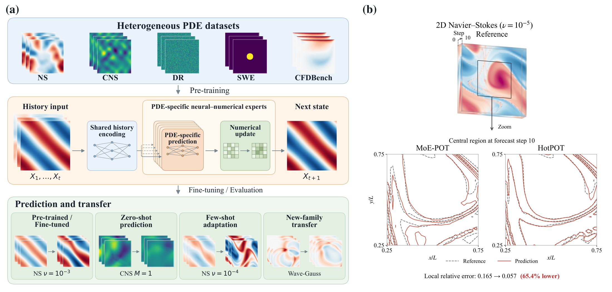
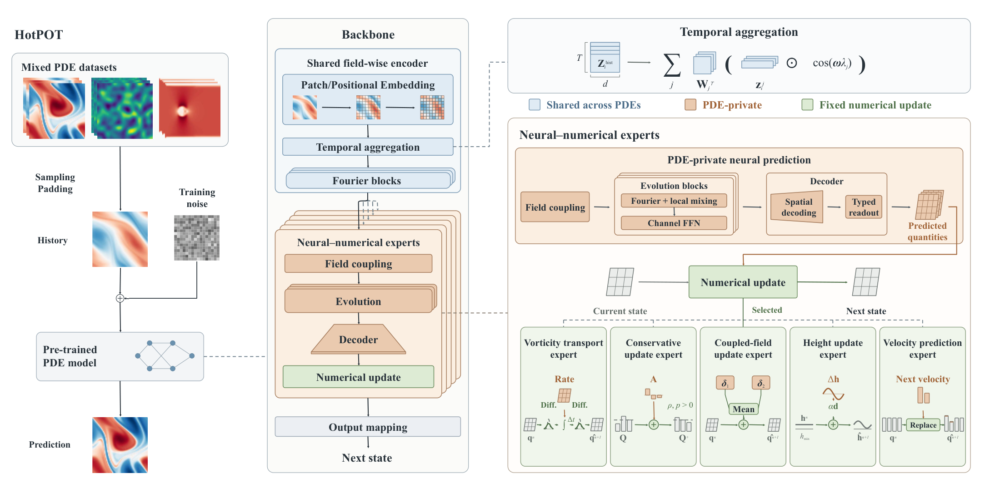

# HotPOT

**Heterogeneous physics experts for large-scale PDE pre-training**

HotPOT shares a field-wise history encoder across PDEs and pairs each PDE-specific neural predictor with a fixed numerical update. The predictor supplies the quantities required by its update, which advances the physical state. This repository accompanies the anonymous manuscript and contains the model, training and evaluation code, ablations, transfer routines, and dataset metadata.



The manuscript evaluates five PDE families across six pre-training settings. HotPOT reduces rollout error by **50.7% on average** over the 24 matched-scale comparisons with MoE-POT before and after fine-tuning. The qualitative NS example above is one local comparison; its highlighted reduction is not the aggregate benchmark result.

## Model



- **Shared history encoding:** the same encoder processes scalar-field histories; PDE-specific modules handle interactions between fields.
- **Neural–numerical experts:** learnable predictors produce update quantities for NS, CNS, SWE, DR, and CFDBench numerical programs.
- **Explicit routing:** the known equation and available conditions determine the expert. A learned mixture router is not required.
- **Transfer:** reuse the pretrained model for known-task fine-tuning and coefficient changes, or reuse its encoder when adapting to the Wave family.

## Installation

Use Python 3.10 or later. Install a CUDA-enabled PyTorch build appropriate for your machine before installing this package. The paper's pre-training configuration uses Linux and two GPUs; CPU is sufficient for the smoke tests.

```bash
python -m venv .venv
source .venv/bin/activate
python -m pip install -e '.[test]'
python -m pytest -q
```

On Windows, activate with `.venv\Scripts\Activate.ps1` in PowerShell. Distributed training uses NCCL and should run on Linux.

## Quick start

```python
import torch
from hotpot import build_model

model = build_model(scale=17).eval()
# [batch, height, width, history frames, padded field channels]
history = torch.rand(1, 128, 128, 10, 4)
with torch.inference_mode():
    next_state = model(
        history,
        dataset_indices=torch.tensor([0]),  # NS, viscosity 1e-5
        row_indices=torch.tensor([0]),
        cfdb_sidecar=None,
    )
print(next_state.shape)  # torch.Size([1, 128, 128, 1, 4])
```

The random input demonstrates the interface only. **17M and 90M refer to activated-parameter scales**, not total stored parameters across all experts. `model.parameter_ledger()` reports both the stored and route-specific counts.

## Data

Follow [the data guide](docs/DATA.md) to obtain and arrange the public datasets. Dataset arrays and trained checkpoints are not included in this source repository. CFDBench row mappings, case conditions, and the Wave split used by the experiments are included in `metadata/`.

```bash
python -m hotpot.prepare --workspace ./workspace
# After downloading and preprocessing the datasets:
python -m hotpot.prepare --workspace ./workspace --check
```

## Pre-training and evaluation

```bash
torchrun --standalone --nproc_per_node=2 -m hotpot.train \
  --scale 17 --variant full \
  --workspace ./workspace --cfdb-sidecar ./workspace/metadata/cfdb_train.json \
  --output ./workspace/runs/full17

python -m hotpot.evaluate \
  --workspace ./workspace --scale 17 --task ns2d_fno_1e-5 \
  --checkpoint ./workspace/runs/full17/checkpoint_e1000.pt \
  --output ./workspace/results/full17_ns.json
```

Use `--scale 90` for the larger model. The standard recipe is 1,000 epochs, global batch size 40, Adam, and a OneCycle schedule; see [reproduction protocols](docs/REPRODUCING.md). Evaluation feeds each model's own predictions back into its history and uses the released native-grid/channel mask.

## Ablations

Pass one of these values to `--variant` in the pre-training and evaluation commands:

| Variant | Question addressed | Change |
| --- | --- | --- |
| `full` | Complete HotPOT | Shared history encoder and PDE-specific neural–numerical experts |
| `untied` | What does sharing the history encoder contribute? | One independently trainable history encoder per PDE family |
| `late` | Where should information be shared? | Move the shared trainable block from history encoding to the later evolution representation |
| `late_untied` | What does sharing the later representation contribute? | Untie the later shared block by PDE family |
| `direct` | What does the neural–numerical design contribute? | Predict the next state directly |
| `generic_iteration` | Are repeated queries alone sufficient? | Replace the NS numerical execution with a generic iterative residual update |

These controls match the paper's two ablation groups: **sharing** and **numerical experts**. Direct prediction changes the predicted quantity, execution, and stage-state queries together. Generic iteration intervenes on the NS path; it does not isolate every factor across all equations. See [the ablation guide](docs/ABLATIONS.md).

## Fine-tuning and transfer

```bash
python -m hotpot.transfer \
  --workspace ./workspace --paths configs/data_paths.json \
  --checkpoint ./workspace/runs/full17/checkpoint_e1000.pt --scale 17 \
  --mode known-train --task ns2d_fno_1e-5 \
  --output ./workspace/runs/ns_finetuned

python -m hotpot.transfer \
  --workspace ./workspace --paths configs/data_paths.json \
  --checkpoint ./workspace/runs/full17/checkpoint_e1000.pt --scale 17 \
  --mode zero-shot --task cns_m1_eta1e-2 \
  --output ./workspace/results/cns_zero_shot
```

The same entry point supports `fewshot-train`, `fewshot-test`, `wave-train`, `wave-test`, and `known-test`. Training and testing use separate invocations. Commands and checkpoint-selection rules are in [REPRODUCING.md](docs/REPRODUCING.md).

## Repository map

```text
hotpot/          public model and execution entry points
  _internal/     encoder, field coupling, numerical programs, data and transfer logic
  _vendor/       attributed AFNO implementation
configs/         paper recipes and portable data-path mapping
metadata/        CFDBench row/case metadata and Wave split
tests/           CPU interface, routing, and checkpoint checks
assets/          manuscript figures in PNG and vector PDF
docs/            data preparation, reproduction, and ablation documentation
```

The release was checked with CPU smoke tests, import checks, and a same-seed comparison with the research implementation. The lightweight model had identical parameters and identical outputs on all eight routing cases. These checks establish packaging equivalence; they do not replace the GPU experiments reported in the paper.

## Acknowledgements

We build on the datasets and evaluation conventions of [MoE-POT](https://github.com/haiyangxin/MoEPOT). The AFNO component retains its upstream attribution. See [THIRD_PARTY_NOTICES.md](THIRD_PARTY_NOTICES.md). Author-identifying contact and citation information is omitted during anonymous review.
