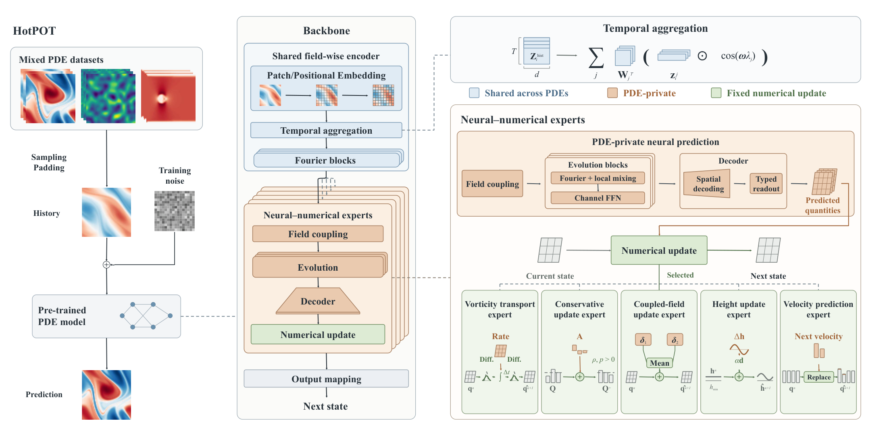

# Model structure



HotPOT shares a scalar-field history encoder across PDEs. Each equation has its own learnable predictor and fixed numerical update. The predictor supplies the update quantities; the numerical program advances the state. The known equation and available conditions select the expert.

## Inference interface

```python
import torch
from hotpot import build_model

model = build_model(scale=17).eval()
history = torch.rand(1, 128, 128, 10, 4)
with torch.inference_mode():
    prediction = model(
        history,
        dataset_indices=torch.tensor([0]),  # NS, viscosity 1e-5
        row_indices=torch.tensor([0]),
        cfdb_sidecar=None,
    )
print(prediction.shape)  # torch.Size([1, 128, 128, 1, 4])
```

This example uses random weights and synthetic input to demonstrate the interface. Load a trained checkpoint with `load_checkpoint(model, path)` for prediction. Inputs have layout `[batch, height, width, history, fields]`, resized to 128 × 128 and padded to four field channels by the data loader. The model returns one next frame in the same channel layout.

Dataset indices follow the six entries in the README table (0–5). CFDBench additionally needs the matching row metadata to select cavity, cylinder, or tube execution. The evaluation entry point loads that metadata automatically when its path is supplied.

## Source map

| Component | Implementation |
| --- | --- |
| Public model and checkpoint loading | [`hotpot/models.py`](../hotpot/models.py) |
| Shared history representation | [`encoder/`](../hotpot/_internal/encoder/) |
| Field coupling and model dimensions | [`foundation/`](../hotpot/_internal/foundation/) |
| Full model and iterative control | [`mechanisms/`](../hotpot/_internal/mechanisms/) |
| Numerical operators and programs | [`operators/`](../hotpot/_internal/operators/), [`numerics/`](../hotpot/_internal/numerics/) |
| Data loading, routing, and objective | [`data_protocol/`](../hotpot/_internal/data_protocol/) |
| Fine-tuning and transfer | [`adaptation/`](../hotpot/_internal/adaptation/) |
| New-family Wave models | [`wave/`](../hotpot/_internal/wave/) |

The 17M and 90M names describe activated scale. Total storage includes every expert and is larger; `model.parameter_ledger()` reports both definitions. Source pre-training uses four NS substeps. Target adaptation uses eight, selected with `build_model(..., target=True)`.
